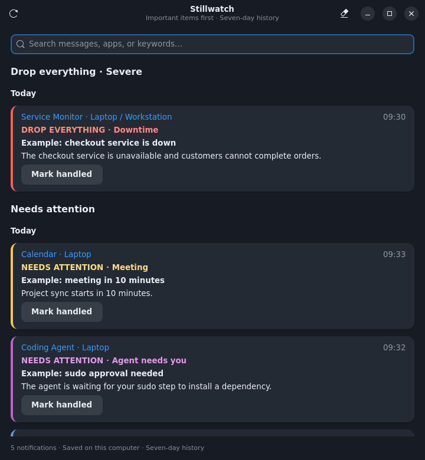
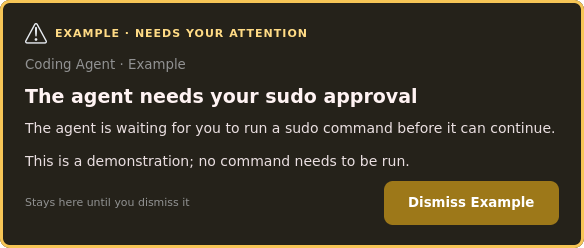
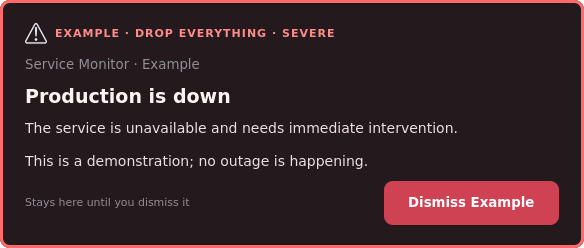

# Stillwatch

**Protect your attention. Direct it to what matters.**

Stillwatch protects your attention across live events from all your apps. In AI mode, a decision model identifies what needs you now and brings it to your attention with persistent modals. Routine events stay in searchable notification history, so you can review them when you're ready.



## What it does

- Saves notifications locally, including transient banners, with search and seven-day history.
- Puts severe events first, then other important items, then routine activity.
- Uses amber for ordinary attention requests and red for drop-everything incidents.
- Suppresses repeat interruptions for five minutes per issue. The first alert is immediate; severe escalation can break cooldown.
- Keeps one outstanding modal per issue until you dismiss or mark it handled.
- Shares deduplicated events and dismissals between paired devices over SSH. Handle an event once to handle it everywhere.
- Treats Slack pings, agents needing input, downtime, and meetings within 15 minutes as examples of important events. The policy is editable.
- Offers an optional compact desktop profile: small technical fonts, a left dock, window previews, app-supplied badges, Alt+Tab window switching, and small tiling gaps.

### Attention, not alarm

An agent waiting for a sudo step gets amber. A serious active outage gets red. Neither has a timeout.

| Needs your attention | Drop everything |
| --- | --- |
|  |  |

These are actual GTK previews rendered with fictional data. Once the GNOME extension loads, attention alerts become desktop-wide system modals with a dimmed background and keyboard/input grab. The screenshots never capture other applications or a real notification database.

## Install

Linux, Python 3.10+, GTK 4, libadwaita, Python GObject bindings, Python D-Bus, and a graphical user session are required. The system-modal extension currently targets **GNOME Shell 50**. Release 0.2.0 is an alpha; other shell versions are not advertised as supported.

On Debian/Ubuntu, install the system dependencies:

```sh
sudo apt install python3 python3-gi python3-dbus gir1.2-gtk-4.0 gir1.2-adw-1
```

Then install as your desktop user, without sudo:

```sh
git clone https://github.com/difflabai/stillwatch.git
cd stillwatch
./install.sh --dry-run
./install.sh
~/.local/bin/stillwatch view
```

The default installation records **local history only** and leaves existing notification banners alone. It creates a user service and an application launcher. It does not read another application's credentials or notification history.

### Opt into AI triage

```sh
~/.local/bin/stillwatch enable-ai
```

Enter your NanoGPT API key at the hidden prompt. Alternatively, supply `NANOGPT_API_KEY` through your own environment. A service copy is stored in `~/.config/stillwatch/nanogpt.env` with mode `0600`; the key is never printed. NanoGPT API usage is paid from that key's account.

Enabling AI sends each **new** notification's app, title, and up to 3,000 body characters to [NanoGPT's Decisions API](https://docs.nano-gpt.com/api-reference/endpoint/decisions), using pinned `typesafe/jev-1.13`. Typed choices classify importance, category, and severity. The default interruption threshold is 0.85, and red also requires severe probability of at least 0.85. History is not retroactively uploaded. You can exclude apps using the policy's `excluded_apps` patterns.

Log out and back in once to load the GNOME extension. Until then, ordinary banners are off, the app uses a GTK modal fallback, and GNOME's native critical alerts can still bypass Do Not Disturb. GTK alone cannot block the entire Wayland desktop.

## Use

```sh
stillwatch view                  # Search history
stillwatch demo                  # Fictional amber alert; no model call
stillwatch demo --severe         # Fictional red alert; no model call
stillwatch doctor               # Dependencies and shell compatibility
stillwatch config               # Policy, never the API key
stillwatch disable-ai            # Local history and restore native banners
stillwatch uninstall             # Remove managed install; retain private data
```

AI mode adds **Super+Shift+N** for the inbox. **Mark handled** acknowledges an important item without deleting its history. Closing or dismissing an attention modal acknowledges its current item. No approval, sudo command, link, or other external action is executed by the notification UI.

Edit `~/.config/stillwatch/config.json`, then restart `systemctl --user restart stillwatch.service`. XDG overrides are honored for configuration, application files, and history. Core defaults include:

```json
{
  "enabled": false,
  "model": "typesafe/jev-1.13",
  "threshold": 0.85,
  "timeout_seconds": 5,
  "max_delay_seconds": 10,
  "cooldown_seconds": 300,
  "excluded_apps": []
}
```

### Shared events across devices

Install Stillwatch on each GNOME 50 device. Choose one device to classify events with NanoGPT; the other devices use its decisions. An existing SSH login with verified host keys is required.

On the other device:

```sh
stillwatch sync satellite --label Workstation
```

On the device running AI triage:

```sh
stillwatch enable-ai
stillwatch sync pair workstation --label Laptop  # Your existing SSH alias
stillwatch sync status
```

Both inboxes show the same events and attention state. Exact normalized app/title/body matches within five minutes merge into one item, with device labels showing where it arrived. Different bodies, numbers, and later occurrences remain separate. Each unique event is classified once on the AI device. Dismiss or mark handled on either device to close the matching attention cards on both. Offline changes catch up after reconnection; handled events are not revived by a retry.

The pairing service polls every two seconds over SSH. Notification content travels only between your paired devices and, when AI is enabled, from the classifier to NanoGPT. No public port or cloud sync server is created, and the API key stays on the classifier. Pre-existing history is not broadcast automatically. Pairing files and machine addresses remain in private runtime configuration.

Once the extension loads after logout/login, matching notifications in GNOME's native history also clear when handled, and explicit native dismissals propagate. Banner expiry and app shutdown do not count as handling. App-owned unread counts are controlled by each app and are separate from notification dismissal. Until the extension loads, shared Stillwatch history and GTK cards work; native-history dismissal integration is pending. Compatibility depends on the desktop shell: GNOME 50 is supported; COSMIC and older GNOME releases are not yet supported.

### Compact workspace profile

```sh
stillwatch profile apply
stillwatch profile apply --terminal  # Also adjust an existing Kitty config
stillwatch profile apply --quiet-crash-reports  # Optional Ubuntu crash-popup quieting
stillwatch profile restore
```

This is separate from notification installation. It preserves vertical space with a left-side dock and skips optional extension settings that are not installed. Changes are recorded for restoration; later user edits to GNOME settings are preserved. The Kitty option saves the prior config and requires a reload.

## Privacy and behavior

Local state is in `~/.local/state/stillwatch/history.sqlite3`, with a `0700` directory and `0600` database. Ordinary history is bounded to seven days / 1,000 entries; unhandled important items remain until acknowledged. Installation backups, keys, and policy are local runtime files, never repository assets.

The recorder monitors only desktop notification interfaces and relevant service ownership changes. It avoids counting Ubuntu's forwarded notification call twice. Notification text is displayed as plain text and is never executed or interpreted as model instructions.

Classification runs asynchronously with four workers and a bounded queue. API errors and queue overload keep messages in history with a review label. Important decisions that arrive more than ten seconds late appear at the top of history without a stale popup. Cooldowns survive service restarts. Issue matching uses app, category, normalized topic, and context for generic titles; differently worded reports can be separate issues.

AI classification can be wrong. Stillwatch's AI mode deliberately suppresses native banners, so it should not be the sole channel for emergency or production-critical alerting. Local-only mode keeps existing native banners.

## Development

```sh
PYTHONPATH=src python3 -m unittest discover -s tests -v
node --input-type=module --check < src/stillwatch/resources/extension/extension.js
node tests/test_extension.mjs
PYTHONPATH=src python3 scripts/screenshots.py
python3 -m build
```

Tests cover typed responses, severity thresholds, privacy permissions, retention, search, priority ordering, cooldown boundaries, restart persistence, escalation, settings restoration, deduplication, bidirectional dismissal, offline recovery, lost replies, and native dismissal hooks. CI has no API key and makes no model requests. Screenshot generation uses an isolated temporary state directory and fictional fixtures. GNOME system-modal integration should be exercised in a GNOME 50 desktop session; mocked hooks and syntax checks are not a substitute for that manual check. See [architecture](docs/architecture.md) and [privacy](docs/privacy.md).

MIT licensed. Created by [mikkel](https://github.com/mikkel), published under [difflabai](https://github.com/difflabai).
