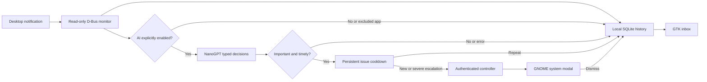

# Architecture

Stillwatch has a Python recorder/inbox and an optional GNOME Shell extension. The components communicate through a private user session's D-Bus.

The monitor observes `org.freedesktop.Notifications.Notify` and `org.gtk.Notifications.AddNotification` without replacing the notification daemon. Public-service ownership is tracked so Ubuntu's forwarding call to Shell is not archived twice. The controller connection is separate from the monitoring connection because a D-Bus monitoring connection cannot make ordinary calls.

The worker pool performs model calls off the GLib event loop. It evaluates typed choices for interruption, category and severity. Raw content never selects a shell command or action. Errors are recorded as a local status, without notification contents or credentials in the journal.

The GNOME extension subscribes to the well-known controller owner. It suppresses native banner creation and uses GNOME's installed `ModalDialog` API, with severe requests ahead of ordinary attention requests. Modals do not expire and wait behind existing system modals. Dismissal is written back to SQLite. A GTK modal fallback is used before the extension loads; it cannot enforce desktop-wide modality on Wayland.

Cooldown identity is a normalized app/category/topic hash, with body context for generic titles. The first important alert fires immediately. Repeated issues are suppressed for 300 seconds, and an issue with an outstanding modal does not accumulate more modals. Escalation from ordinary attention to severe bypasses the cooldown. A differently worded notification may form another identity; this is heuristic grouping, not semantic incident tracking.

The installer copies only package files into an XDG application directory, writes a user systemd unit and launcher, and records owned files. GNOME settings changes have a separate undo ledger. Notification triage and the compact desktop profile are separate opt-ins. Uninstallation restores managed files/settings where unchanged and keeps private configuration/history.
