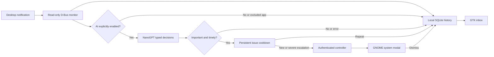

# Architecture

Stillwatch has a Python recorder/inbox and an optional GNOME Shell extension. The components communicate through a private user session's D-Bus.

The monitor observes `org.freedesktop.Notifications.Notify` and `org.gtk.Notifications.AddNotification` without replacing the notification daemon. Public-service ownership is tracked so Ubuntu's forwarding call to Shell is not archived twice. The controller connection is separate from the monitoring connection because a D-Bus monitoring connection cannot make ordinary calls.

The worker pool performs model calls off the GLib event loop. It evaluates typed choices for interruption, category and severity. Raw content never selects a shell command or action. Errors are recorded as a local status, without notification contents or credentials in the journal.

The GNOME extension subscribes to the well-known controller owner. It suppresses native banner creation and uses GNOME's installed `ModalDialog` API, with severe requests ahead of ordinary attention requests. Modals do not expire and wait behind existing system modals. Dismissal is written back to SQLite. A GTK modal fallback is used before the extension loads; it cannot enforce desktop-wide modality on Wayland.

Cooldown identity is a normalized app/category/topic hash, with body context for generic titles and agent requests. The first important alert fires immediately. Repeated issues are suppressed for 300 seconds, and an issue with an outstanding modal does not accumulate more modals. Escalation from ordinary attention to severe bypasses the cooldown. A differently worded notification may form another identity; this is heuristic grouping, not semantic incident tracking.

The installer copies only package files into an XDG application directory, writes a user systemd unit and launcher, and records owned files. GNOME settings changes have a separate undo ledger. Notification triage and the compact desktop profile are separate opt-ins. Uninstallation restores managed files/settings where unchanged and keeps private configuration/history.

## Shared state

Each device has a random private identity. Capture creates a UUID event and an idempotent operation. A separate pairing service exchanges ordered batches over an existing SSH login, saving per-peer cursors only after a successful transaction. Lost replies and retries cannot duplicate operations. Imported operations keep their IDs, so bidirectional replication has no echo loop.

App/title/body fingerprints use Unicode and whitespace normalization with a few explicit app-ID aliases. Matching content within 300 seconds links multiple deliveries to one inbox row; numbers and bodies are preserved to avoid merging separate work. This event deduplication is stricter than issue-level interruption cooldowns. One chosen classifier processes unclassified shared events; satellites display its decisions without cloud calls. Dismissal is monotonic, covers linked deliveries, and survives reconnection through event-ID tombstones.

The loaded GNOME gate observes explicit native notification dismissal before GNOME removes its source, and ignores expiration, replacement, and source shutdown. Shared handling removes matching native notifications without generating an echo acknowledgement. This hook targets the [GNOME Shell 50 notification API](https://github.com/GNOME/gnome-shell/blob/50.1/js/ui/messageTray.js); mocked tests verify hook behavior, while full session integration remains a manual check.

## Authority and delivery checks

The chosen server pins its device identity as the authority and stamps decision operations with that producer. Replicas accept only that authority's classifications; capture and monotonic dismissal remain available on either device. Changing the authority requires explicit pairing. The server recorder runs under the user manager's default target with no graphical-session PartOf dependency; user lingering keeps it alive after logout. Its D-Bus monitor handles notification-service ownership appearing again when a desktop logs in.

A popup requires the model's explicit interrupt choice. Agent requests use a 0.65 probability threshold; the general threshold stays at 0.85 and severity still requires 0.85 severe probability. Agent request text contributes to cooldown identity, so different approval requests sharing a conversation title do not suppress one another. The real GTK alert constructor obtains a Python `Gio.DBusConnection` with `Gio.bus_get_sync`; GJS-only `Gio.DBus.session` is not valid in PyGObject. A headless constructor test exercises that non-demo branch and close-to-dismiss behavior on an isolated bus.

## Optional mobile bridge

An opt-in HTTPS service runs on the authority, bound to loopback by default. Each phone receives an independent bearer credential and pins the exact TLS certificate from a private pairing file. The server stores token hashes and accepts only capture/dismiss operations from phones; phones cannot classify. Stable operation IDs and a private Android SQLite outbox support lost-reply retries.

Phone events carry explicit per-app cloud consent, false by default. Non-consenting events receive a replicated excluded decision atomically with ingestion. Changed shared state returns as canonical snapshots so linked events share an alert and acknowledgement. Timely important decisions generate ordinary Android notifications which a watch can mirror. See [mobile setup](mobile.md) for platform limits and required real-device checks.
